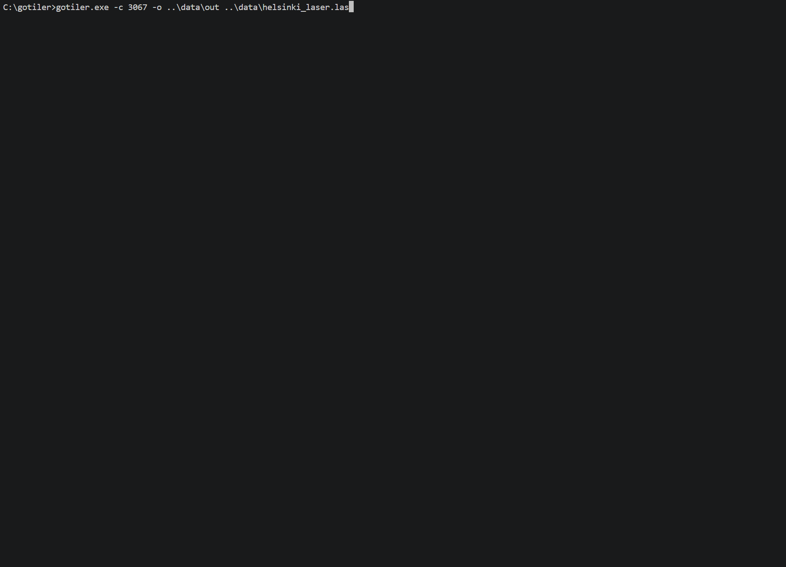

<p align="center">
  
</p>

<p align="center">
  <a href="https://github.com/mfbonfigli/gotiler/actions/workflows/build.yml?query=branch%3Av3"></a>
  <a href="https://github.com/mfbonfigli/gotiler/releases/latest"></a>
  <a href="go.mod"></a>
  <a href="LICENSE.md"></a>
</p>

**gotiler** (formerly *gocesiumtiler*) is a fast, feature-rich, lightweight and portable converter that turns massive **point clouds** and **3D Gaussian splat** scenes into streaming-ready **OGC 3D Tiles**, for **CesiumJS** and other 3D Tiles viewers. Its out-of-core engine uses every CPU core and little memory and can quickly tile large datasets in a few minutes even on modest hardware.

<p align="center">
  <a href="https://mfbonfigli.github.io/gotiler/"><b>📖 Documentation</b></a> ·
  <a href="https://mfbonfigli.github.io/gotiler/demo/"><b>🚀 Live demo</b></a> ·
  <a href="https://mfbonfigli.github.io/gotiler/getting-started/installation/">Installation</a> ·
  <a href="https://mfbonfigli.github.io/gotiler/getting-started/quick-start/">Quick start</a> ·
  <a href="https://mfbonfigli.github.io/gotiler/reference/cli-flags/">CLI flags</a> ·
  <a href="https://pkg.go.dev/github.com/mfbonfigli/gotiler/v3">Go API</a>
</p>

## Features

* **Point cloud** and **Gaussian splat** tiling, with multiple input formats supported.
* **Fast and out-of-core:** uses every CPU core and fast NVMe drives, and tiles billion-point clouds and scenes of hundreds of millions of splats without running out of RAM.
* **Self-contained:** one executable and its data folder is all you need to tile on Linux, macOS and Windows.

### Point cloud tiling, with `gotiler pcloud`

* **LAS, LAZ, E57 and PLY input:** supports LAS/LAZ, E57 scans and ASCII or binary PLY.
* **Automatic reprojection:** reads the CRS from LAS metadata and transforms coordinates with the embedded PROJ library.
* **3D Tiles 1.0 and 1.1:** outputs `.pnts` or `.glb` glTF tiles, optionally packed into a single `.3tz` archive.
* **Compressed by default:** supports meshopt compression and quantization to cut 3D Tiles 1.1 tilesets by 70% or more.
* **Per-point attributes:** intensity, classification, GPS time, LAS extra bytes or any other attribute of the input.
* **Colorization:** 36 color ramps to colorize based on any attribute or coordinate. You can even colorize from an RGB GeoTIFF orthophoto.

### Gaussian splats, with `gotiler splat`

* **PLY input:** reads splat scenes in PLY format, with spherical harmonics up to degree 3.
* **SPZ compression:** SPZ-compressed glTF tiles with the `KHR_gaussian_splatting` extensions that CesiumJS reads.
* **Levels of detail:** built without retraining, by merging splats in pairs using smart algorithms.
* **Lighter tilesets:** choose the spherical-harmonic degree to keep and the opacity below which splats are dropped.

## Demo



*15.9M points from a thinned [Helsinki dataset](https://doi.org/10.5281/zenodo.5578198), tiled in 3.7 seconds on an Intel Core i5-13600K with a Samsung 980 PRO NVMe SSD.*

Fly through point clouds tiled by **gotiler** in the [live demo](https://mfbonfigli.github.io/gotiler/demo/).

## Benchmarks

Time and peak memory to tile the [Helsinki point cloud](https://zenodo.org/records/5578198) (313M points, 13 GB LAS file), measured on the same AWS EC2 `i4i.2xlarge` instance running Ubuntu 24.04. [scripts/benchmark.sh](scripts/benchmark.sh) reproduces the runs.

| tool | execution time | max memory |
|------|----------------|------------|
| **gotiler v3.0** | **1m 50s** | **605 MB** |
| [py3dtiles 12.1.1](https://gitlab.com/py3dtiles/py3dtiles) | 7m 11s | 2.56 GB |
| [mago 3d tiler 1.15.4](https://github.com/Gaia3D/mago-3d-tiler) | 14m 17s | 16.81 GB |

`gotiler splat` tiles the [Lublin, Poland](https://superspl.at/scene/2f1ddf5f) scene, 259M Gaussian splats in a 16.3 GB PLY file, in **5m 50s** with its default options, on a desktop with an Intel Core i5-13600K, 32 GB of RAM and a Samsung 980 PRO NVMe SSD running Windows 11.

## Installation

On Linux (x86_64 or ARM64) and macOS (Apple Silicon, macOS 12 or later):

```bash
curl -fsSL https://github.com/mfbonfigli/gotiler/releases/latest/download/install.sh | sh
```

On 64-bit Windows, in PowerShell:

```powershell
irm https://github.com/mfbonfigli/gotiler/releases/latest/download/install.ps1 | iex
```

Both scripts check the download against the release's checksums and need no administrator rights. To update, uninstall, choose the install folder or a release, or download an archive by hand, see [Installation](https://mfbonfigli.github.io/gotiler/getting-started/installation/).

## Quick start

```bash
# Tile a LAS, LAZ, E57 or PLY file into ./out
gotiler pcloud -o ./out ./input.las

# Merge a folder into one tileset, packed as a .3tz archive
gotiler pcloud -o ./out --join --3tz ./las_folder

# Set the input CRS, color points by elevation and open the result on a globe
gotiler pcloud -o ./out -c EPSG:32633 --colorize z:viridis --preview ./input.las

# Tile a Gaussian splat scene, then place it on the globe
gotiler splat -o ./out --input-up-axis -y ./scene.ply
```

`gotiler help` lists the commands, `gotiler help pcloud` the flags of one, and the [Quick start](https://mfbonfigli.github.io/gotiler/getting-started/quick-start/) walks through a first tileset.

## Documentation

The full documentation lives at **[mfbonfigli.github.io/gotiler](https://mfbonfigli.github.io/gotiler/)**:

* **Guides:** [Point clouds](https://mfbonfigli.github.io/gotiler/guides/input-formats/), [Gaussian splats](https://mfbonfigli.github.io/gotiler/guides/gaussian-splats/input-and-placement/), [Viewing and positioning](https://mfbonfigli.github.io/gotiler/guides/viewer/)
* **Reference:** [CLI flags](https://mfbonfigli.github.io/gotiler/reference/cli-flags/), [Color ramps](https://mfbonfigli.github.io/gotiler/reference/color-ramps/)
* **Go library:** [Library guide](https://mfbonfigli.github.io/gotiler/library/overview/), to embed the tiling engine, and its [API reference](https://pkg.go.dev/github.com/mfbonfigli/gotiler/v3)
* **Project:** [Development](https://mfbonfigli.github.io/gotiler/project/development/), to build **gotiler** from source

## Support the project

**gotiler** is an AGPLv3 open-source project maintained with love. If it saves you time or resources, consider **[making a donation](https://ko-fi.com/mfbonfigli)** to support ongoing maintenance, or starring the repository.

## License

**gotiler** is distributed under the GNU AGPLv3, see [LICENSE.md](LICENSE.md). The executables include third-party code and data: see [THIRD-PARTY-LICENSES.md](THIRD-PARTY-LICENSES.md) for their licenses. Each release archive ships the copy generated for its platform.

If the AGPLv3 terms don't fit your use case, for example to embed the engine in proprietary software or services, commercial licenses are available: please get in touch with the maintainer through [GitHub](https://github.com/mfbonfigli).

## Acknowledgments

- [Photorealistic and classified urban point cloud dataset (Helsinki)](https://doi.org/10.5281/zenodo.5578198) by Julin, A., & Rantanen, T. (2021), used for the benchmarks and, thinned, for the demo animation. Licensed under [CC BY 4.0](https://creativecommons.org/licenses/by/4.0/).
- The Lublin, Poland Gaussian splat scene, used for the splat benchmark: 3D scanning data created and provided by [Andrii Shramko](https://www.linkedin.com/in/andrii-shramko/), [Teleportour](https://www.linkedin.com/company/teleportour/) · [teleportour.com](https://teleportour.com).
- The Go gopher mascot was originally designed by Renee French and is licensed under the Creative Commons 4.0 Attribution License.

## Disclaimer

This project is an independent utility and is not affiliated with, sponsored by, or endorsed by Cesium GS, Inc. "Cesium" is a registered trademark of Cesium GS, Inc.
